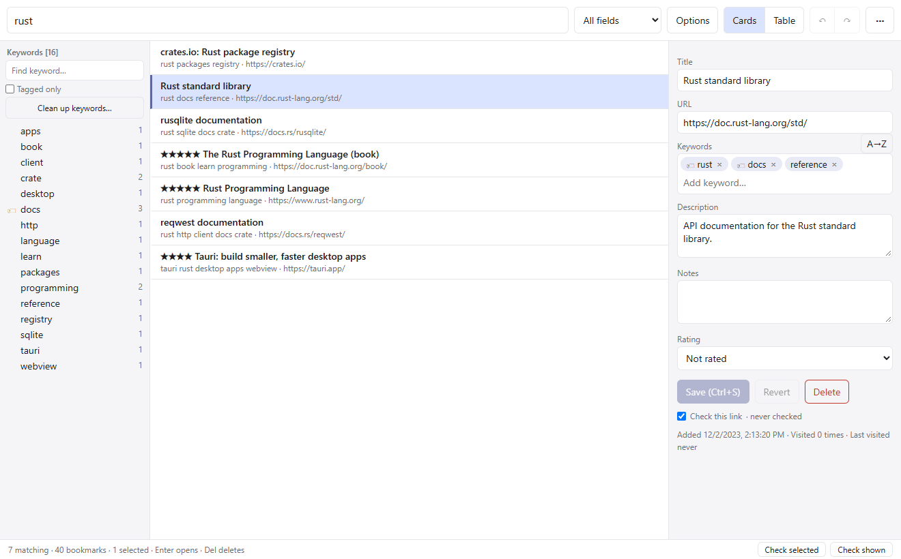
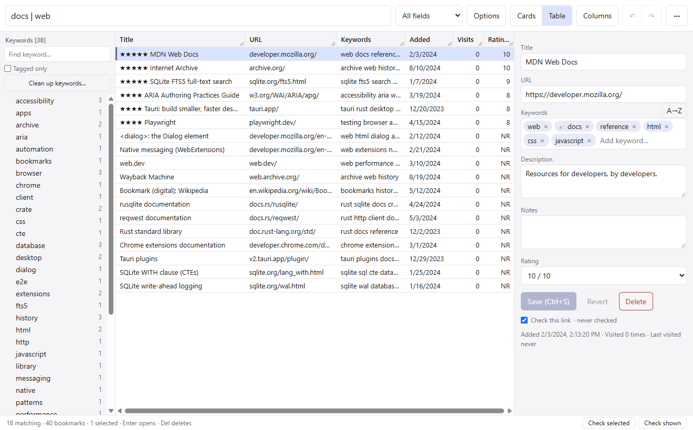
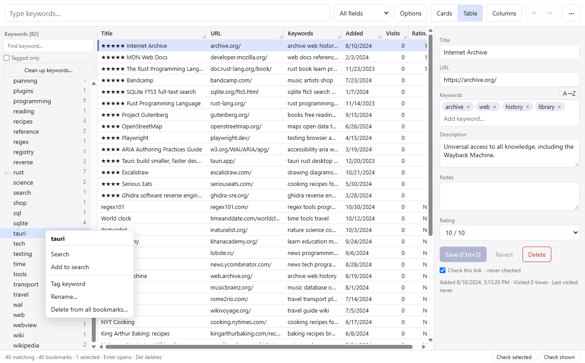
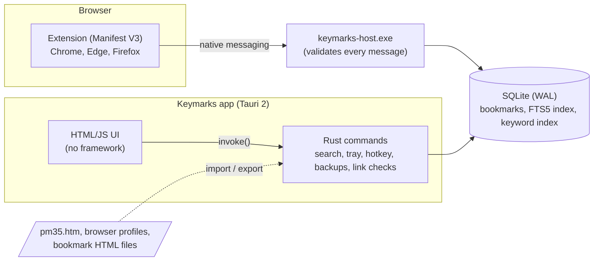

# Keymarks

**A keyword-first bookmark manager for Windows and today's browsers, rebuilt from the ideas of Powermarks 3.5.**

Type a few words, see the bookmarks that match, press Enter. No folders to file things in, no
cloud account, no browser lock-in: one local database you can search the way you think.



> Keymarks is an independent project. It is not affiliated with Kaylon Technologies, and it
> contains none of Powermarks' code, binaries or documentation. It can import Powermarks
> 3.5 files, which it reads using a format description recovered for interoperability.

---

## Why this exists

I've tried a lot of bookmark managers, and none of the standalone ones fit how I work.
The closest was **Powermarks**: a small Windows program from 2002 that treated bookmarks as
a personal search engine. Each bookmark carries keywords, there are no folders, and the list
narrows as you type. I bought a licence years ago and built up more than 13,000 bookmarks
in it.

Kaylon Technologies is gone. The program still runs, but it only talks to Internet Explorer,
Netscape and Opera, and my bookmarks were locked in its own file format.

So this project is two things:

- **A demo of solving a real need end to end.** That meant recovering an old program's data
  format and feature set, then rebuilding it with modern technology and UX.
- **My first Tauri app, built with AI assistance** ([Claude Code](https://claude.com/claude-code)).
  It's an honest record of what that workflow looks like, including the bugs it caught and the
  ones it introduced.

## What it does

- **Instant keyword search.** Results update on every keystroke. The original's syntax
  works: `a b` means both, `a | b` either, `a ! b` without, `( )` groups, and `word.`
  matches whole words only. Keyword matches rank first. There are also *Keywords only*
  and *Exact text* modes; the latter is for searches like `github.com/` in URLs.
- **Keyword dictionary.** A panel lists every keyword with counts and narrows to the
  current results. Click a keyword to refine the search. You can tag favourite keywords,
  rename or merge one across all bookmarks, and run a **cleanup** that previews changes
  first (common words, numbers, plurals).
- **Saved searches and links**, like Powermarks' macros. Save a search with ☆ (its mode
  and fields too), pin a bookmark as a link, run any of them with a click or Alt+1…9, and
  reorder them.
- **Editing.** A properties panel with a tag-style keyword editor and autocomplete,
  multi-select, delete, and **undo/redo** with named steps (Ctrl+Z / Ctrl+Y).
- **Cards or table view.** Choose from 11 columns, sort by up to two keys (as the
  original did), and scroll through all your bookmarks without a cap.
- **Browser extension** (Chrome, Edge, Firefox). One click adds the current page,
  prefilled with its title, description and keywords. On a page you already have, it
  edits that bookmark instead. **Fast add** (Alt+Shift+K, or right-click a page or link)
  adds without a popup and tags the bookmark `new` for later review. The app's list
  updates live.
- **Quick adding in the app.** Insert opens New bookmark, and Alt+Insert adds every link on
  the clipboard. Titles and descriptions are fetched from the pages in the background.
- **Always at hand.** A global hotkey brings the window up, the tray menu lists the top
  results of your current search, and the app can start with Windows. Only one copy ever
  runs.
- **Link checking.** Finds dead, blocked and changed pages, a few requests at a time.
  "Changed" ignores ads, scripts and timestamps. It fixes the URLs of pages that moved
  permanently, as an undoable step. Checks only run when you ask.
- **Safe with your data.** It backs up on every start and keeps a copy of your largest
  collection so far, which survives an accidental mass delete. It also backs up before any
  cleanup or restore, and you can restore from inside the app.
- **Import from Chrome, Edge and Firefox** (every profile), or any exported bookmarks
  file. Folders become keywords, duplicates are skipped, and each import can be undone.
- **Lossless Powermarks import, and export back.** It reads `pm35.htm` byte for byte and
  repairs text the original had stored double- or triple-encoded, even when one field mixes
  encodings. It can write a `pm35.htm` the original program can open again, or a bookmarks
  HTML file for any browser. Both round-trip a real 13,000-bookmark collection exactly.

| Table view, `docs \| web` sorted by rating | Keyword dictionary actions |
|---|---|
|  |  |

*Screenshots use the demo collection in [docs/demo](docs/demo/bookmarks.html) (public sites
only). Rebuild it with `cargo run -p store --example demo -- <folder>` and re-shoot with
`node e2e/screenshots.mjs <folder>`.*

## How it was built

### 1. Recovering the data format

Powermarks stores its database as bookmark HTML with an undocumented record of 15 fields
per bookmark (`<!--mdata=[…]-->`). I decompiled `pm.exe` with **Ghidra** through
[REA](https://github.com/morluto/rea), an MCP server that lets the AI assistant drive
reverse-engineering tools. That way I could read the routines that write the file and the
routines that export it under human-readable labels such as "Added:", "Last Visited:" and
"Rating:". Matching the two named each field from the program itself rather than by
guessing. The result is a short, sourced spec: **[docs/pm35-format.md](docs/pm35-format.md)**.

The importer is tested by **round-tripping** a real 13,057-entry database byte for byte.
Reading the real data also turned up problems the format spec couldn't predict: text in
mixed encodings, and 803 titles that had been double- or triple-encoded over the years.

### 2. Recovering the requirements

I wanted near feature parity, so the next step was an inventory. It drew on the HTML
manual, the changelog, every setting in `pm35.ini`, and text strings in the executable,
which turned up features the manual never mentions. The result is
**[docs/requirements.md](docs/requirements.md)**: 190 features, each with its source, a
modern approach, a priority and a status. Obsolete parts (Netscape DDE, IE toolbars,
trial nags) are explicitly dropped, with the reason.

**Progress:** 74 of 104 core features done and 13 partial. See the doc for the full
scoreboard.

### 3. Architecture



| Crate / folder | Role |
|---|---|
| `pm35/` | Lossless reader/writer for Powermarks 3.5 files (no dependencies) |
| `store/` | SQLite store: FTS5 search, query parser, keyword index, cleanup, undo/redo |
| `app/` | Tauri desktop app: commands, tray, hotkey, backups, UI in `app/ui/` |
| `host/` | Native-messaging host used by the extension |
| `extension/` | Manifest V3 extension (Chrome, Edge, Firefox) |
| `e2e/` | End-to-end test that drives the real app |
| `docs/` | Format spec and requirements |

A few decisions worth noting:

- **The search syntax compiles to SQL.** A small recursive-descent parser turns each term
  into an FTS5 subquery and combines them in SQL, so even a query that starts with NOT
  (`!google`) works. SQLite's full-text search can't express that on its own.
- **One performance bug worth remembering.** The first version took **25 seconds** per
  search, because SQLite re-ranked the matches for every row. A `MATERIALIZED` CTE brought
  it to about 15 ms. The real-data test now fails if a search takes over a second.
- **Undo restores only the rows a change touched.** Each step stores before-and-after
  snapshots of those rows. Undoing a cleanup that touched 1,885 keywords restores the
  dictionary exactly, and bookmarks the extension added in the meantime are never affected.
- **Security at the boundaries.**
  - Only http(s), ftp, file and mailto links are handed to Windows.
  - Imported titles are only ever inserted as text, never as HTML.
  - The native host validates every message.
  - Sort columns go through an allow-list.
  - Backup names are checked before a restore.

### 4. Testing

- **Unit tests** (`cargo test --workspace`): format round-trips, every search operator and
  mode, keyword rename/merge, cleanup rules, undo/redo of each kind of change, backup
  rotation, host message framing, and link-check statuses, change detection and redirects
  against a local HTTP server.
- **Real-data tests** (optional, `PM35_REAL=…\pm35.htm cargo test -- --ignored`): import,
  round-trip and timing on a real collection, an exact-undo check after a full cleanup, and
  both export formats read back field by field.
- **End-to-end** (`e2e/`, 49 checks in about 30 s): starts the real app with WebView2's
  debugging port open and drives it with Playwright. It types queries, switches modes,
  sorts, scrolls to the last row, edits, deletes, undoes, checks single-instance, and runs
  a link check against a local test server (it never contacts real sites).
  - It runs on a **temporary copy** of the database.
  - Its checks compare results to each other rather than to fixed numbers (for example,
    `a b` returns no more than `a`), so they pass on anyone's collection.
  - Its output contains counts only, never bookmark text.

### 5. Working with an AI assistant

Most of the code was written by Claude Code, with me deciding what to build and checking
the result. Some things that shaped the workflow:

- **Tests and screenshots kept it honest.** Visual checks caught a CSS class collision that
  broke the table layout, and a cleanup dialog whose preview was hidden. The e2e test caught
  a "busy" signal that fired before saves had finished. An early "no garbled titles" claim
  turned out to be wrong because the check missed one pattern.
- **Privacy rules from day one.** My bookmark collection is private. Test output, logs and
  this repository contain counts and synthetic fixtures only.
- **Small, readable commits.** The history is the build log.

## Running it

Requirements: Windows 10/11, the [Rust](https://rustup.rs) MSVC toolchain, and Visual Studio
Build Tools with C++. WebView2 ships with Windows.

```powershell
cargo build --workspace                      # app + native host
target\debug\keymarks-host.exe --install     # register the host for Chrome, Edge, Firefox
target\debug\keymarks.exe                    # run; use "Import pm35.htm…" or the extension
```

To load the extension: open `chrome://extensions` (or `edge://extensions`), turn on
**Developer mode**, click **Load unpacked**, and choose `extension/`. In Firefox, use
`about:debugging` and load it as a temporary add-on.

Tests: `cargo test --workspace`, then `cd e2e && npm install && npm run smoke`. The
end-to-end test closes and reopens the app.

Data lives in `%APPDATA%\com.pattern158.keymarks\` (`bookmarks.db`, `settings.json`,
`backups\`).

## Roadmap

Next, from the requirements doc:

- **Scheduled link checking** (opt-in), plus pause and resume.
- **Two-way sync** between PCs.

## Licence

[MIT](LICENSE).

*Powermarks is a trademark of Kaylon Technologies. Keymarks is not affiliated with or
endorsed by Kaylon Technologies.*
